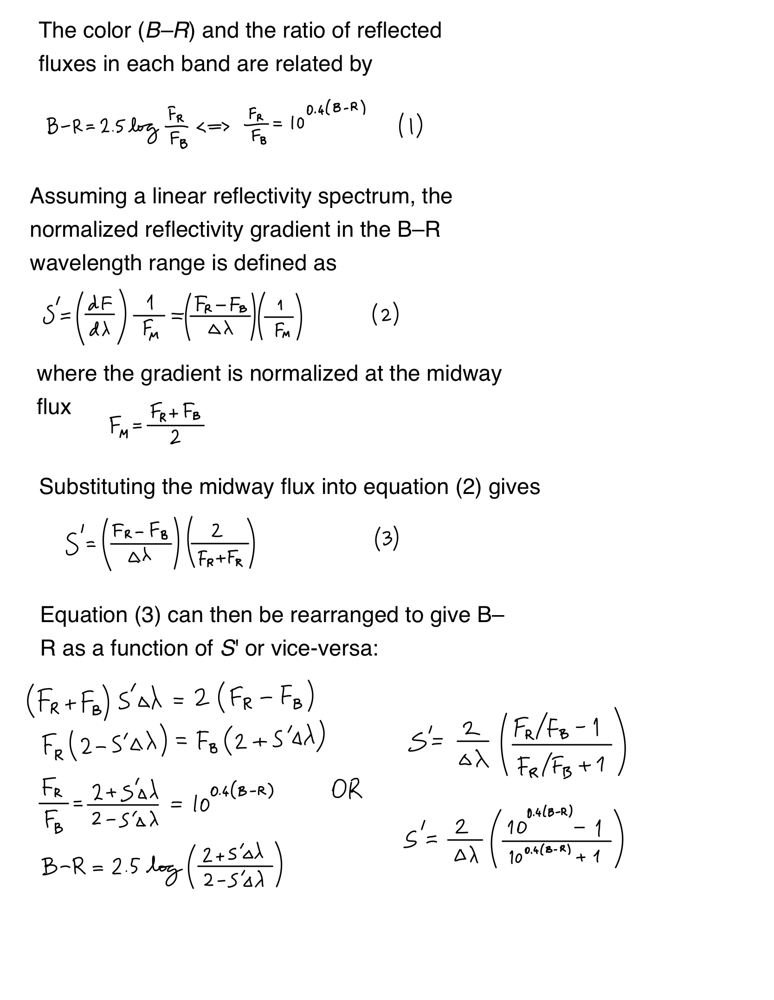

# Color to Spectral Slope and Back

The surface compositions of small solar system bodies can in principle be investigated from Earth by measuring reflectivity spectra across a range of UV to IR wavelengths. The ratio of the reflected spectrum to that of sunlight reveals a continuum “color” peppered by absorption bands diagnostic of minerals and ices present on the surfaces. However, most small bodies are too faint for spectroscopy. In practice, the most accessible way to study the surfaces is through broadband colors. These at least give an idea of what the reflectivity continuum looks like.

Color is the ratio of reflectivities at two different wavelengths. We measure the reflected fluxes (or magnitudes) through two different filters and take the ratio (or subtract) to calculate the color.

Many small bodies have approximately **linear reflectivity** spectra that are nearly featureless in the visible wavelength range. As a result, the color measured between any two wavelengths in that range is directly related to the gradient of the spectrum. The gradient of the spectrum is commonly referred to as **spectral slope** and represented as \$S'\$.

The advantage of \$S'\$ is that it can be used to compare photometric data taken in different bands. However, the idea of exchanging color for **spectral slope loses meaning if the reflectivity is clearly non-linear**.

Here, I derive the formula that relates spectral slope to broadband color. I will take as an example the broadband filters \$B\$ and \$R\$, which have approximate effective wavelengths \$\lambda_B = 445\,\mathrm{nm}\$ and \$\lambda_R = 660\,\mathrm{nm}\$. Their wavelength separation is

\$\$\Delta\lambda = \lambda_R - \lambda_B = 215\,\mathrm{nm}.\$\$

## Color and the flux ratio

The color \$B-R\$ and the ratio of reflected fluxes in the two bands are related by

\$\$B-R = 2.5\log_{10}\!\left(\frac{F_R}{F_B}\right)
\quad\Longleftrightarrow\quad
\frac{F_R}{F_B} = 10^{0.4(B-R)}.\tag{1}\$\$

Here, \$F_B\$ and \$F_R\$ are the reflected fluxes measured through the \$B\$ and \$R\$ filters, respectively.

## Defining the spectral slope

Assuming a linear reflectivity spectrum, the normalized reflectivity gradient over the \$B-R\$ wavelength range is

\$\$S' = \left(\frac{dF}{d\lambda}\right)\frac{1}{F_m}
= \left(\frac{F_R-F_B}{\Delta\lambda}\right)\left(\frac{1}{F_m}\right),\tag{2}\$\$

where the gradient is normalized by the flux midway between the two bands:

\$\$F_m = \frac{F_R+F_B}{2}.\$\$

Substituting the midpoint flux into equation (2) gives

\$\$S' = \left(\frac{F_R-F_B}{\Delta\lambda}\right)
\left(\frac{2}{F_R+F_B}\right)
= \frac{2(F_R-F_B)}{\Delta\lambda(F_R+F_B)}.\tag{3}\$\$

## Converting between color and spectral slope

Rearranging equation (3) gives

\$\$(F_R+F_B)S'\Delta\lambda = 2(F_R-F_B),\$\$

and therefore

\$\$F_R(2-S'\Delta\lambda) = F_B(2+S'\Delta\lambda).\$\$

The flux ratio can thus be written in terms of spectral slope:

\$\$\frac{F_R}{F_B}
= \frac{2+S'\Delta\lambda}{2-S'\Delta\lambda}.
\tag{4}\$\$

Combining this result with equation (1), the color as a function of spectral slope is

\$\$B-R = 2.5\log_{10}\!\left(
\frac{2+S'\Delta\lambda}{2-S'\Delta\lambda}
\right).\$\$

Conversely, the spectral slope as a function of color is

\$\$S' = \frac{2}{\Delta\lambda}
\left(\frac{F_R/F_B-1}{F_R/F_B+1}\right)
= \frac{2}{\Delta\lambda}
\left(\frac{10^{0.4(B-R)}-1}{10^{0.4(B-R)}+1}\right).\tag{5}\$\$

With \$\Delta\lambda\$ expressed in nanometres, \$S'\$ is in inverse nanometres. The equations assume a linear reflectivity spectrum across the two filters; they should not be used as a conversion for a clearly non-linear spectrum.

View the original handwritten derivation

Pedro Lacerda, May 2021

<link rel="stylesheet" href="https://cdn.jsdelivr.net/npm/katex@0.19.1/dist/katex.min.css" integrity="sha384-WwGtaC6ywCHxA5cstpj/3+xIZvTez8dq2IcBQaXRkenHZ7FVVq1ZROtURwfbtTlG" crossorigin="anonymous">

