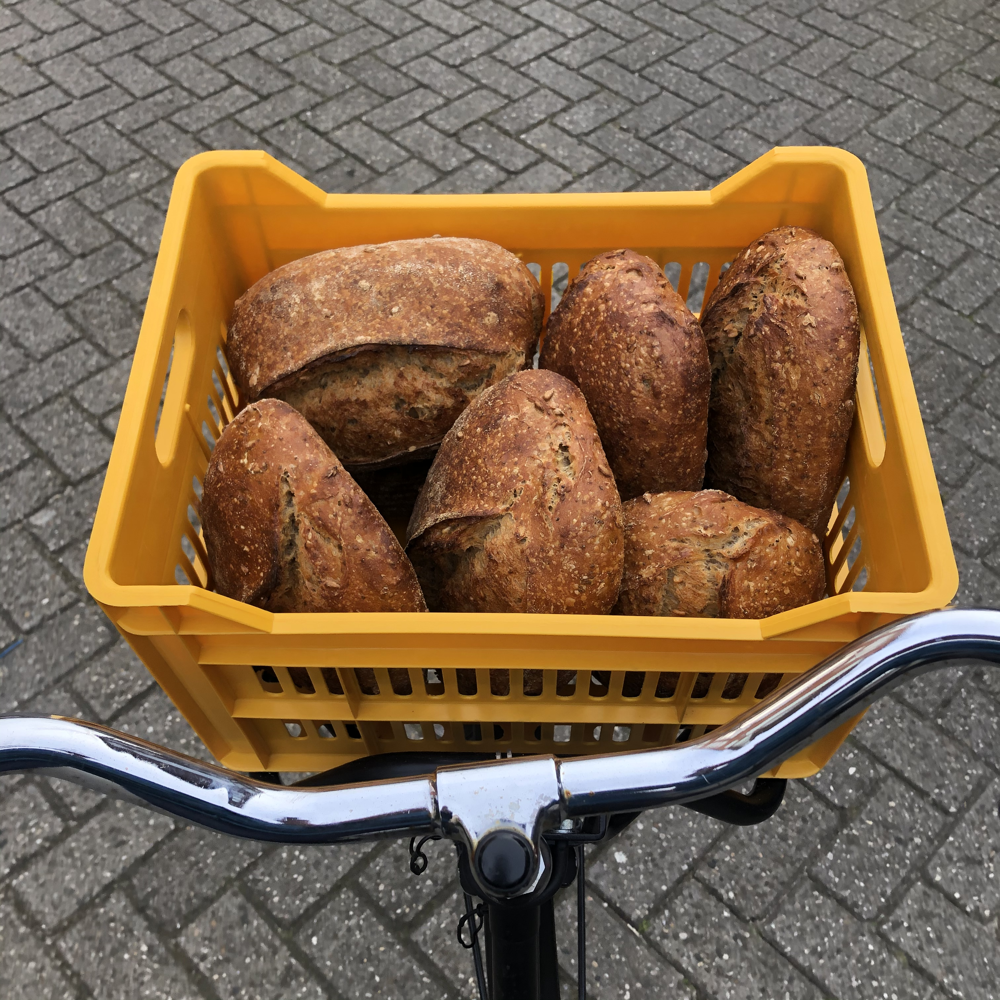
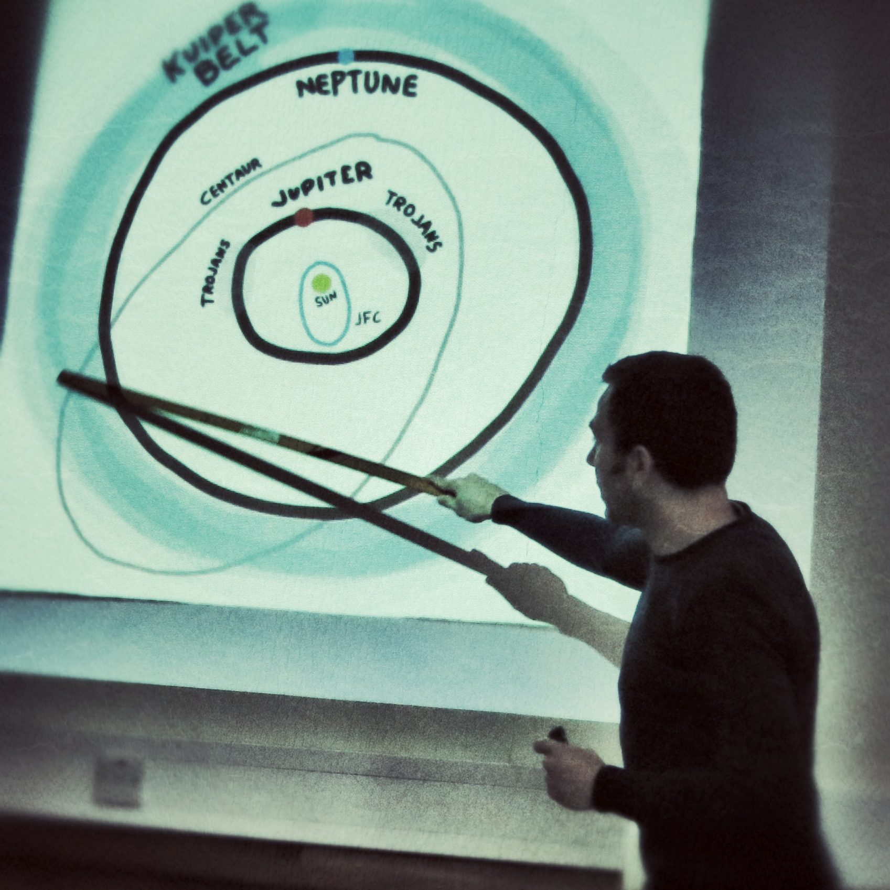

<main class="miolo-page">
<header class="miolo-hero">
<h1>Miolo</h1>

Learn. Enjoy.

Miolo was a project that combined sourdough bread and mathematics. It was my full-time job during the COVID-19 pandemic. The project is now suspended; this page preserves what Miolo was.

</header>

<section>
<h2>Bread</h2>

I started baking bread around 2006 and have baked almost daily since 2016. At Miolo, I baked sourdough bread and delivered it weekly to neighbours in Deventer.

</section>

<section>
<h2>Mathematics</h2>

Numbers, geometry, symmetries, and patterns have always made me happy. Through Miolo, I shared that joy by teaching mathematics, physics, and astronomy.

</section>

<section class="miolo-about">
<h2>About me</h2>

I was born and grew up in Portugal. Since 2000, I have lived in eight different cities in the Netherlands, the United States, the United Kingdom, and Germany.

I studied engineering, physics, and astronomy, and have worked as a scientist doing <a href="/research">research in astronomy</a> and teaching at universities. I have also given private mathematics and physics lessons, many of them online during the pandemic.

Bread is one of the foundations of Portuguese food. I have always loved bread, and in recent years I began baking it obsessively.

</section>
</main>
